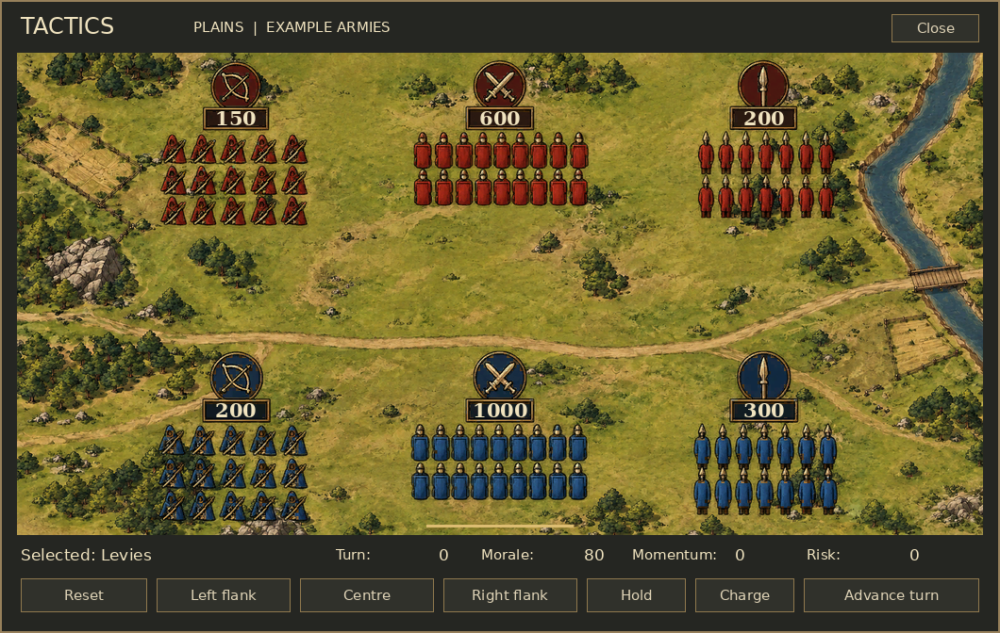

# Veni, Vidi, Vici (VVV) ⚔️

Tactical warfare mod for **vanilla Crusader Kings III**.

**Version:** 0.1.3-alpha | **Target:** CK3 1.20.x

## The 2D battlefield



This is an **offline layout preview**, not an in-game screenshot. Native CK3 window/button skins and fonts are approximated; the terrain, formations, coordinates, troop counts and labels come from the mod's actual files.

- Large, overhead **2D plains battlefield** with separate transparent formations.
- Red enemy above: **150 archers, 600 levies, 200 light infantry**.
- Blue army below: **200 archers, 1,000 levies, 300 light infantry**.
- Counts are native GUI text, not painted into the landscape.
- Click a blue formation to select it. Left/centre/right exchanges it with the formation occupying that flank, so friendly units remain separate.
- Reset, hold, charge and turn commands use player-character drill variables.
- Opening Tactics prepares the board automatically, including on older alpha saves.
- Runtime art uses **legacy DDS DXT1/DXT5**, with transparent alpha for troops. The old PNG GUI paths are no longer used.

**These are example armies. The panel does not yet read, pause, replace or control live CK3 combat.** Normal battles continue to resolve normally.

## Install and open from a battle

1. Build with `python -m tools.package`, or download the **VVV-0.1.3** artifact from a successful GitHub Actions run.
2. Extract `VVV-0.1.3.zip` into `Documents/Paradox Interactive/Crusader Kings III/mod/`. Keep `VVV.mod` beside the `VVV` folder.
3. On Windows, run **`InstallBattleButton.cmd` inside the VVV folder**. It needs Python 3.10+ and attempts to find your Steam installation automatically. It writes only a VVV override, leaving the game installation untouched.
4. Enable VVV, restart CK3, open an active battle and look for **Tactics beside the native window controls**.
5. Click Tactics. The six formations and their counts should appear immediately.

If automatic detection fails, run from the VVV directory:

```bash
python -m tools.install_battle_button --game-dir "D:/SteamLibrary/steamapps/common/Crusader Kings III"
```

Re-run the installer after CK3 updates. `--refresh` backs up and refreshes a previous VVV override; it refuses to replace an unrelated override. Other mods replacing `gui/window_combat.gui` need a merged compatibility patch.

**Debug fallback:** with `-debug_mode`, the temporary bottom-right map button still opens the same board. It is hidden in normal play. The repository and CI package intentionally do not redistribute a complete vanilla combat GUI; the local installer supplies the version-specific hook.

## Development and verification

```bash
python tools/validate.py
python -m unittest discover -s tests -v
python -m tools.tactics
python -m tools.package
```

For art builds and previews, install Pillow 11.3+:

```bash
python -m pip install "Pillow>=11.3"
python -m tools.build_art
python -m tools.preview_ui
```

Python is a setup/development tool; it **does not run inside CK3**. The installer and static checks use the standard library only.

See [testing](docs/TESTING.md), [battle-button integration](docs/BATTLE_VIEW_INTEGRATION.md), [UI research](docs/UI_RESEARCH.md), [architecture](docs/ARCHITECTURE.md), [roadmap](docs/ROADMAP.md), [limitations](docs/LIMITATIONS.md) and [art sources](art/README.md).
